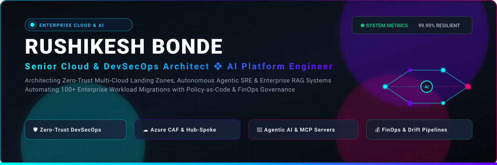
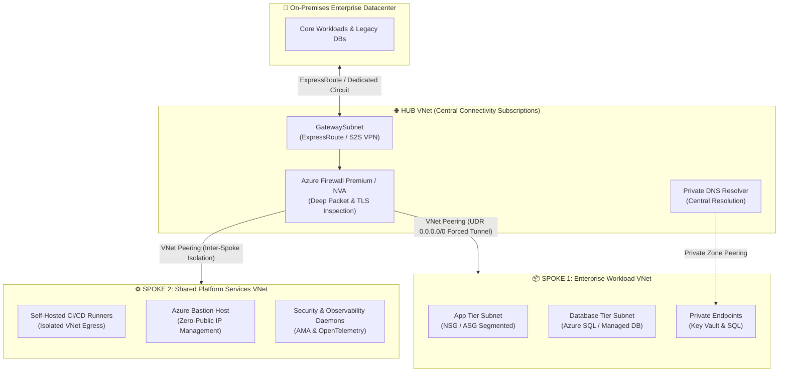
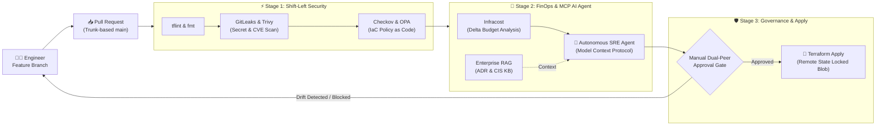

<div align="center">

  <!-- Header Vector Banner -->
  <a href="https://github.com/rushi-bonde">
    
  </a>

  <br/><br/>

  <!-- Dynamic Animated Typing SVG -->
  <a href="https://readme-typing-svg.demolab.com/">
    
  </a>

  <br/>

  <!-- Shields Badges: Connect, Status, Cloud & AI Protocols -->
  <p align="center">
    <a href="https://linkedin.com/in/rushikesh-bonde" target="_blank">
      
    </a>
    <a href="mailto:rushikeshbonde@outlook.com">
      
    </a>
    <a href="https://github.com/rushi-bonde?tab=repositories">
      
    </a>
    <a href="https://azure.microsoft.com/">
      
    </a>
    <a href="https://modelcontextprotocol.io/">
      
    </a>
  </p>

</div>

---

## 📌 Project Overview & Architectural Mission

This portfolio repository houses the architectural blueprints, infrastructure code modules, and autonomous operational frameworks designed by **Rushikesh Bonde**. It bridges the gap between **strategic enterprise cloud architecture (Azure Cloud Adoption Framework)**, **Zero-Trust DevSecOps**, and next-generation **Autonomous AI Systems (Model Context Protocol & Enterprise RAG)**.

### Core Philosophy
> *"True engineering excellence in modern infrastructure is not merely deploying resources or running pipelines—it is designing self-healing, auditable systems that align business velocity with institutional security, FinOps rigor, and autonomous AI-driven operations."*

Whether orchestrating end-to-end migrations of **100+ enterprise workloads**, enforcing **Policy-as-Code gates** with automated rollbacks, or wiring **autonomous SRE agents via MCP**, these systems are engineered for:
* **99.99% Availability** across multi-availability zones.
* **Sub-15 Minute RPO** and **Zero-Downtime** database cutovers.
* **25–35% Cloud Cost Optimization** via active FinOps governance.

---

## ✨ Key Architectural Features

<table>
  <tr>
    <td width="50%" valign="top">
      <h3>☁️ Enterprise Landing Zones (Azure CAF)</h3>
      <ul>
        <li><strong>Management Hierarchy:</strong> Tenant root group, platform management groups (Identity, Management, Connectivity), and isolated workload subscriptions (Dev, UAT, Prod).</li>
        <li><strong>Hub-and-Spoke Topology:</strong> Centralized Azure Firewall Premium with TLS inspection, UDR <code>0.0.0.0/0</code> forced tunneling, and zero public IP exposure for PaaS via Private Endpoints.</li>
        <li><strong>100+ Workload Migration Engine:</strong> 5-phase structured lifecycle from Azure Migrate discovery to hypercare war room operations.</li>
      </ul>
    </td>
    <td width="50%" valign="top">
      <h3>🛡️ Zero-Trust DevSecOps & Governance</h3>
      <ul>
        <li><strong>Shift-Left Automated Scanning:</strong> Pre-commit and CI gates enforcing <code>GitLeaks</code> (secrets), <code>Checkov</code> (IaC policies), and <code>Trivy</code> (container CVEs).</li>
        <li><strong>Policy-as-Code:</strong> CIS Azure Foundations & Microsoft Cloud Security Benchmark initiatives assigned with audit/deny controls.</li>
        <li><strong>Identity & Access (IAM):</strong> Microsoft Entra ID Privileged Identity Management (PIM) with JIT access, Conditional Access, and Managed Identities.</li>
      </ul>
    </td>
  </tr>
  <tr>
    <td width="50%" valign="top">
      <h3>🤖 Autonomous AI & Model Context Protocol (MCP)</h3>
      <ul>
        <li><strong>MCP Diagnostic Servers:</strong> Custom Model Context Protocol server exposing K8s crash triage (<code>CrashLoopBackOff</code>, <code>OOMKilled</code>) and drift analysis directly to LLMs.</li>
        <li><strong>Enterprise RAG Engine:</strong> Vector database indexing Architecture Decision Records (ADRs) for instant compliance queries.</li>
        <li><strong>Self-Healing Telemetry:</strong> Multi-agent incident triage capable of generating automated drift remediation pull requests.</li>
      </ul>
    </td>
    <td width="50%" valign="top">
      <h3>💰 FinOps & SRE Reliability</h3>
      <ul>
        <li><strong>Unit Economics:</strong> Automated reclamation of orphaned disks, snapshots, and idle IPs; dynamic rightsizing based on 30-day 95th-percentile utilization.</li>
        <li><strong>Log Telemetry Tuning:</strong> Azure Monitor Agent (AMA) Data Collection Rules (DCR) filtering noisy logs at source to slash Log Analytics ingestion costs by 30%+.</li>
        <li><strong>Resilience & DR:</strong> Paired regional DR with Azure Site Recovery (ASR) and LRS/ZRS/GRS storage redundancy.</li>
      </ul>
    </td>
  </tr>
</table>

---

## 🧰 Technologies Used & Toolchain

<div align="center">

<a href="https://skillicons.dev">
  
</a>

</div>

<br/>

| Domain | Technologies & Frameworks |
| :--- | :--- |
| **Cloud Infrastructure** | Microsoft Azure (CAF, Landing Zones, VNets, Hub-Spoke, NSGs, Private Endpoints, Key Vault, Azure Monitor, ASR), AWS, Hybrid Datacenter |
| **Infrastructure as Code** | Terraform (`>= 1.6`), Terragrunt, HCL (`for_each`, nested `dynamic` blocks, complex `map` objects), Azure Blob Lease Remote State Locking |
| **AI Systems & Protocols** | Model Context Protocol (MCP), Autonomous SRE Agents, Enterprise RAG (Retrieval-Augmented Generation), LangChain, LlamaIndex, ChromaDB |
| **CI/CD & Delivery** | GitHub Actions, Azure DevOps Pipelines (YAML), Trunk-Based Development, Branch Protection Policies, Infracost Budget Gates |
| **DevSecOps & Security** | GitLeaks, Checkov, Trivy, tfsec, HashiCorp Vault, Microsoft Entra ID (PIM, RBAC, Managed Identities), Kyverno, SLSA Compliance |
| **Containers & Orchestration** | Docker, Kubernetes (AKS), Helm, Micro-segmentation, Container Security Hardening |
| **Observability & SRE** | Prometheus, Grafana, Azure Monitor Agent (AMA), Data Collection Rules (DCR), OpenTelemetry, SLI/SLO Error Budgets |
| **Scripting & Systems** | Linux (Ubuntu/Debian), Bash, PowerShell, Python 3.11+, Git |

---

## 📐 System Architecture Diagrams

### 1. Enterprise Hub-and-Spoke Landing Zone & Zero-Trust Perimeter

This architecture reflects production-grade enterprise topology built aligned with Microsoft Cloud Adoption Framework (CAF). Centralizes traffic inspection, isolates blast radiuses across subscriptions, and eliminates public IP exposure through PaaS Private Endpoints.



---

### 2. Autonomous DevSecOps & AI SRE Agent Pipeline (MCP Protocol)

Integrating standard CI/CD with modern **Model Context Protocol (MCP)** agents. When an engineer raises an IaC pull request, autonomous AI agents cross-examine Terraform plans against CIS security benchmarks, FinOps spending thresholds via Infracost, and live cluster state before triggering production approval gates.



---

### 3. End-to-End Enterprise Cloud Migration Framework (100+ Workloads)

A proven 5-phase migration lifecycle designed to transition heterogeneous enterprise estates from legacy bare-metal/virtualized on-prem datacenters into Microsoft Azure with zero unexpected downtime.

```
+--------------------+     +---------------------+     +--------------------+     +-------------------+     +---------------------+
|   1. DISCOVERY     |     |   2. ASSESSMENT     |     |   3. READINESS     |     |    4. CUTOVER     |     |   5. HYPERCARE      |
|                    | --> |                     | --> |                    | --> |                   | --> |                     |
| • Azure Migrate    |     | • TCO & ROI Models  |     | • Target Landing   |     | • DB Sync (ASR)   |     | • 24x7 War Room     |
| • Server Inventory |     | • 10 Quality Pillars|     |   Zone Deployed    |     | • DNS TTL Cut     |     | • Perf Benchmarking |
| • Dependency Maps  |     | • 6 R's Strategy    |     | • RBAC & PIM Set   |     | • Traffic Reroute |     | • FinOps Audit      |
| • Bandwidth Sizing |     | • Wave Planning     |     | • CI/CD & Security |     | • Zero-Downtime   |     | • Knowledge Handover|
+--------------------+     +---------------------+     +--------------------+     +-------------------+     +---------------------+
```

---

## 🏆 Featured Live Repositories & Artifacts

| Project | Description & Technologies | Production Artifacts |
| :--- | :--- | :--- |
| 🏢 **[azure-enterprise-landingzone-tf](https://github.com/rushi-bonde/azure-enterprise-landingzone-tf)** | Modular Terraform Landing Zones implementing Azure CAF, Hub-and-Spoke networking, and complex HCL (`for_each`, `dynamic` blocks, nested maps). | • [Repository](https://github.com/rushi-bonde/azure-enterprise-landingzone-tf)<br/>• [Threat Model](https://github.com/rushi-bonde/azure-enterprise-landingzone-tf/blob/main/docs/threat-model.md)<br/>• [Operations Runbook](https://github.com/rushi-bonde/azure-enterprise-landingzone-tf/blob/main/docs/operations-runbook.md)<br/>• [CI Workflow](https://github.com/rushi-bonde/azure-enterprise-landingzone-tf/blob/main/.github/workflows/terraform-ci.yml) |
| 🤖 **[mcp-cloud-sre-agent](https://github.com/rushi-bonde/mcp-cloud-sre-agent)** | Autonomous AI SRE diagnostic assistant built on the **Model Context Protocol (MCP)** standard. Connects LLMs to live K8s telemetry, Terraform drift, and FinOps spikes. | • [Repository](https://github.com/rushi-bonde/mcp-cloud-sre-agent)<br/>• [Architecture Guide](https://github.com/rushi-bonde/mcp-cloud-sre-agent/blob/main/docs/architecture.md)<br/>• [Client MCP Config](https://github.com/rushi-bonde/mcp-cloud-sre-agent/blob/main/mcp_config.json)<br/>• [Dockerfile](https://github.com/rushi-bonde/mcp-cloud-sre-agent/blob/main/Dockerfile) |
| 🛡️ **[devsecops-golden-pipeline](https://github.com/rushi-bonde/devsecops-golden-pipeline)** | Multi-stage reusable pipeline templates (GitHub Actions & Azure DevOps) enforcing GitLeaks secrets scanning, Checkov IaC posture, and Infracost FinOps budgets. | • [Repository](https://github.com/rushi-bonde/devsecops-golden-pipeline)<br/>• [Threat Model](https://github.com/rushi-bonde/devsecops-golden-pipeline/blob/main/docs/threat-model.md)<br/>• [GitHub Actions](https://github.com/rushi-bonde/devsecops-golden-pipeline/blob/main/.github/workflows/golden-pipeline.yml)<br/>• [Azure DevOps YAML](https://github.com/rushi-bonde/devsecops-golden-pipeline/blob/main/azure-pipelines/azure-pipelines.yml) |
| 🧠 **[rag-architecture-decision-kb](https://github.com/rushi-bonde/rag-architecture-decision-kb)** | Enterprise RAG knowledge engine indexing Architecture Decision Records (ADRs) and CIS benchmarks for automated compliance audits and CLI queries. | • [Repository](https://github.com/rushi-bonde/rag-architecture-decision-kb)<br/>• [Decision Records (ADRs)](https://github.com/rushi-bonde/rag-architecture-decision-kb/tree/main/adrs)<br/>• [Vector RAG Engine](https://github.com/rushi-bonde/rag-architecture-decision-kb/blob/main/engine.py)<br/>• [Interactive CLI](https://github.com/rushi-bonde/rag-architecture-decision-kb/blob/main/cli.py) |

---

## 🚀 Setup & Validation Instructions

Follow the steps below to locally clone, inspect, test, and validate each production module in this architecture.

### 1. Prerequisites
Ensure your local workstation has the following tools installed:
* **Terraform** `>= 1.6.0`
* **Python** `3.11+`
* **Docker Engine**
* **Azure CLI** (`az login`)
* **Security Scanners:** `tflint`, `checkov`, `gitleaks`

---

### 2. Validating Terraform Enterprise Landing Zones
```bash
# Clone the landing zone repository
git clone https://github.com/rushi-bonde/azure-enterprise-landingzone-tf.git
cd azure-enterprise-landingzone-tf/environments/prod

# Initialize Terraform with backend configuration
terraform init

# Run syntax formatting check & static analysis
terraform fmt -check -recursive ../../
tflint

# Run Checkov security policy evaluation against all modules
checkov -d ../../modules

# Generate execution plan
terraform plan -var-file="terraform.tfvars"
```

---

### 3. Running the Model Context Protocol (MCP) AI SRE Server
```bash
# Clone the MCP server repository
git clone https://github.com/rushi-bonde/mcp-cloud-sre-agent.git
cd mcp-cloud-sre-agent

# Create and activate Python virtual environment
python -m venv venv
source venv/bin/activate  # On Windows: .\venv\Scripts\Activate.ps1

# Install dependencies and run test suite
pip install -r requirements.txt
pytest tests/

# Start the MCP server locally (JSON-RPC loop)
python server.py
```

To connect this server to **Claude Desktop**, add the following to your `claude_desktop_config.json`:
```json
{
  "mcpServers": {
    "cloud-sre-agent": {
      "command": "python",
      "args": ["/absolute/path/to/mcp-cloud-sre-agent/server.py"]
    }
  }
}
```

---

### 4. Querying the Enterprise Architecture RAG Engine
```bash
# Clone the RAG knowledge base repository
git clone https://github.com/rushi-bonde/rag-architecture-decision-kb.git
cd rag-architecture-decision-kb

# Install requirements
pip install -r requirements.txt

# Run semantic queries against Architecture Decision Records
python cli.py "Hub and Spoke firewall forced tunneling"
python cli.py "Customer Managed Keys encryption requirements"
```

---

## 🎯 Strategic Leadership & Senior Mindset

<details>
<summary><strong>🔍 Click to expand: The 10 Scalability & Quality Pillars for Enterprise Systems</strong></summary>
<br/>

Every cloud migration and architecture I design is strictly validated against these 10 core non-negotiable architectural pillars:

1. **Scalable:** Elastic horizontal auto-scaling (VMSS, AKS HPA/KEDA) to absorb peak traffic without manual intervention.
2. **Robust:** Fault-isolated failure domains with automated retry loops and circuit breakers.
3. **Secure:** Multi-layered defense-in-depth across identity, network, compute, and data tiers with zero trust.
4. **Reliable:** Engineered for 99.99% uptime with rigorous chaos testing and automated failovers.
5. **Portable:** Containerized workloads with standard OCI images and cloud-agnostic Terraform abstractions.
6. **Governed:** Automated guardrails via Azure Policy with mandatory audit/deny initiatives.
7. **High Availability:** Active-active regional deployments with multi-AZ replication.
8. **Cost-Optimized:** FinOps discipline, dynamic rightsizing, and continuous elimination of idle resources.
9. **Backed Up:** Multi-tier backups with immutable vaults, strict retention policies, and automated drill tests.
10. **Compliant & Monitored:** Full telemetry via Azure Monitor Agent (AMA), DCR filtering, and CIS/ISO27001 audit traces.

</details>

<details>
<summary><strong>📋 Click to expand: Vendor Management, SOW & Delivery Governance Lifecycle</strong></summary>
<br/>

Architecture is meaningless without rigorous execution and governance. I structure enterprise vendor relationships, partner deliverables, and cross-functional handoffs using formal accountability frameworks:

* **Procurement Lifecycle:** `RFI` (Information Gathering) ➔ `RFP` (Technical Proposal) ➔ `Technical Evaluation Matrix` ➔ `SOW & Commercial Terms` ➔ `Sprint Milestones` ➔ `Acceptance Sign-Off`.
* **Technical Evaluation Matrix:** Standardized scoring system grading proposals across architecture compliance, security posture, vendor track record, and multi-year TCO.
* **RACI Framework:**
  * **R (Responsible):** Hand-on execution engineers.
  * **A (Accountable):** Single lead architect answerable for deliverable completion.
  * **C (Consulted):** Domain experts (Infra, Security, FinOps, Data).
  * **I (Informed):** Executive sponsors and program managers.
* **Escalation Path & SLA Enforcement:** Contractual mitigation workflows when technical roadblocks or contractual breaches occur.
* **Formal Handover & Hypercare:** Architecture Decision Records (ADRs), runbooks, recorded walkthroughs, and minimum 2–4 weeks war room shadowing.

</details>

<details>
<summary><strong>🛡️ Click to expand: Multi-Layered Defense-in-Depth Specification</strong></summary>
<br/>

| Tier | Controls & Enterprise Implementation |
| :--- | :--- |
| **Identity & Access** | Microsoft Entra ID, Conditional Access Policies, Phishing-resistant MFA, Privileged Identity Management (PIM) with JIT elevation, Managed Identities for zero credential exposure. |
| **Network Perimeter** | Hub-Spoke topology, micro-segmentation via NSG/ASG, Azure Firewall Premium with TLS inspection, Private Endpoints for PaaS, DDoS Protection. |
| **Policy & Governance** | Azure Policy Initiatives (CIS Azure Foundations, MCSB), Policy-as-Code in Terraform, automated drift detection pipelines. |
| **Data & Storage** | Encryption at rest using Customer-Managed Keys (CMK) via Azure Key Vault with Soft-Delete & Purge Protection; TLS 1.3 in transit; Private Endpoints. |
| **Compute & Containers** | Defender for Cloud & Defender for Servers, automated vulnerability patching, Trivy image scanning, Kyverno admission controllers. |

</details>

<details>
<summary><strong>💰 Click to expand: FinOps (Cloud Financial Management) Framework</strong></summary>
<br/>

* **Waste Reclamation:** Nightly automated scans detecting unattached managed disks, orphaned snapshots, unassociated public IPs, and idle gateway resources.
* **Rightsizing Algorithms:** Continuous VM and container rightsizing based on 30-day 95th-percentile CPU and memory metrics.
* **Commitment Architectures:** Portfolio blend of 1-Year / 3-Year Reserved Instances (RI) and Azure Savings Plans covering steady-state baseline workloads.
* **Automated Non-Prod Scheduling:** Automated start/stop for dev/test environments saving up to ~65% in non-production compute bills.
* **Telemetry Cost Tuning:** Data Collection Rules (DCR) configured on Azure Monitor Agent to drop noisy debug traces at source, reducing Log Analytics ingestion costs by 30%+.

</details>

---

## 📊 Live GitHub Analytics

<div align="center">
  <table border="0">
    <tr>
      <td width="50%" align="center">
        <a href="https://github.com/rushi-bonde">
          
        </a>
      </td>
      <td width="50%" align="center">
        <a href="https://github.com/rushi-bonde">
          
        </a>
      </td>
    </tr>
    <tr>
      <td colspan="2" align="center">
        <a href="https://github.com/rushi-bonde">
          
        </a>
      </td>
    </tr>
  </table>
</div>

---

## 🤝 Connect & Collaboration

I am actively open to discussions, technical consultations, and high-impact enterprise roles in **Cloud & Platform Architecture**, **Senior DevSecOps**, **Autonomous AI Systems (MCP)**, and **FinOps**.

<div align="center">

<p align="center">
  <a href="https://linkedin.com/in/rushikesh-bonde" target="_blank">
    
  </a>
  &nbsp;&nbsp;
  <a href="mailto:rushikeshbonde@outlook.com">
    
  </a>
  &nbsp;&nbsp;
  <a href="https://github.com/rushi-bonde?tab=repositories">
    
  </a>
</p>

<sub>Architected with precision, zero-trust discipline, and relentless AI innovation by <strong>Rushikesh Bonde</strong>.</sub>

<br/><br/>


</div>
